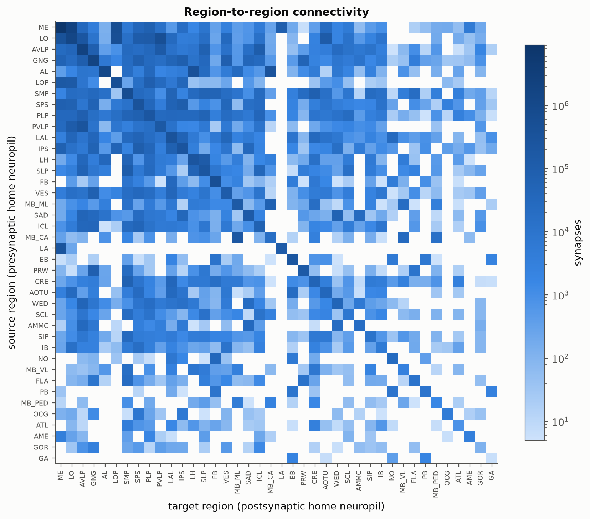

# connectome-control

Can the wiring of a real brain make a better robot controller?
This project turns the FlyWire whole-brain connectome of *Drosophila*
into a simulated controller for a walking fly in MuJoCo.

**Status:** Phase 1 complete (`v0.1-graph`): the brain as a signed sparse graph.



*Synapses between brain regions (FlyWire v783, connections with ≥5 synapses). Each neuron is
assigned to the neuropil where it receives the most input; hemispheres merged.*

## The graph at a glance

| | |
|---|---|
| Neurons | 134,181 |
| Connections (≥5 synapses) | 2,700,513 |
| Synapses | 34,153,566 |
| Excitatory / inhibitory synapse share | 0.573 / 0.409 |

The connectome is stored as a SciPy CSR matrix with `W[i, j]` = signed input from neuron *j* to
neuron *i* (ACH +1, GABA −1, GLUT −1, modulatory 0), so the input to every neuron is `W @ r`.

## Takeaways

- **Hubs are real.** The average neuron has ~20 strong input partners, but the most
  connected one has 5,080 inputs, and one neuron sends output to 6,399 others.
  Both degree distributions have heavy, roughly power-law tails.
- **Wiring is mostly local.** 57.9% of synapses connect neurons homed in the same region.
- **Regions differ sharply in E/I balance.** The mushroom body lobes are ~75–83% excitatory
  (its Kenyon cells are cholinergic), while the ellipsoid body (the fly's heading
  compass) is ~69% inhibitory, as are SAD and AMMC (antennal mechanosensory areas).
  The antennal lobe stands out with ~21% modulatory input.

## Quick start

```powershell
python -m venv .venv
.\.venv\Scripts\Activate.ps1
pip install -e ".[dev]"
python scripts/download_data.py     # FlyWire v783 from Zenodo, MD5-checked (~1 GB)
python scripts/build_graph.py       # -> data/processed/graph_v783_min5.npz
pytest
jupyter lab notebooks/01_graph.ipynb
```

## Roadmap
- [x] Phase 0: setup and data pipeline (download, checksums, neuropil collapse, threshold)
- [x] Phase 1: the brain as a graph (signed sparse matrix, home neuropils, degree / weight /
      region statistics) — `v0.1-graph`
- [ ] Phase 2: tracing a sensorimotor pathway
- [ ] Phase 3: spiking simulation (Brian2 reference + PyTorch GPU)
- [ ] Phase 4: closed-loop control and wiring benchmark

## Repository layout
```
src/c2c/data/loaders.py        raw FlyWire table -> collapsed, thresholded edge list
src/c2c/data/graph.py          edge list -> signed CSR matrix, home neuropils, .npz save/load
src/c2c/analysis/graph_stats.py degree, weight, region and E/I statistics + figures
scripts/                       download_data.py, build_graph.py
notebooks/01_graph.ipynb       Phase 1 analysis; figures saved to results/figures/
tests/                         pytest on small synthetic connectomes
```

## Data
FlyWire v783 connectivity (CC-BY 4.0), Dorkenwald et al. 2024; neurotransmitter predictions
from Eckstein et al. 2024.
