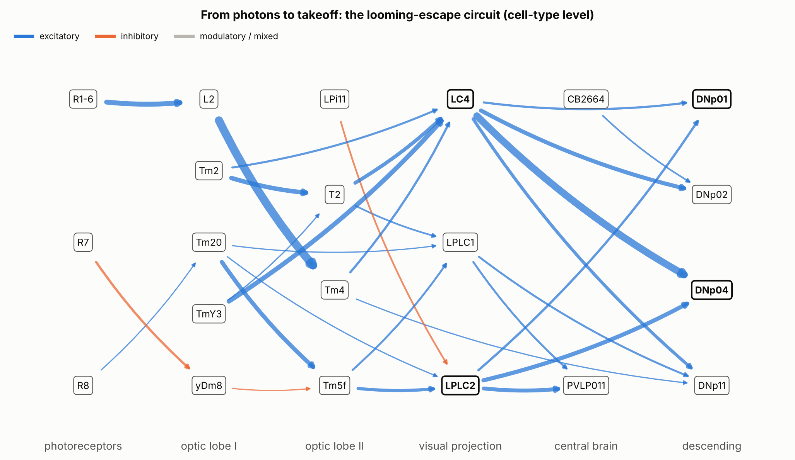
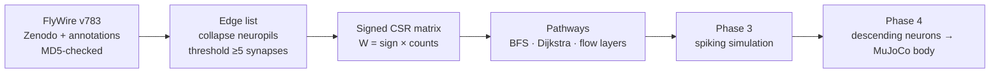

# connectome-control

A fly decides to escape in a few milliseconds. No training run, no reward shaping: the decision is
wired in. This project reads that wiring from the FlyWire whole-brain connectome of *Drosophila*
and asks a robotics question: **if you know which neural pathway produces which action, can you
use the brain's own wiring as a controller?**

**Status:** Phase 2 complete (`v0.2-pathway`): sensory input traced all the way to the neurons that
drive the body.

## The 30-second version

- A fly brain is 134,181 neurons and 2.7 million strong connections. I store it as one signed
  sparse matrix, so "who excites whom" becomes linear algebra.
- Behaviour leaves the brain through about 1,300 **descending neurons**, the brain's output
  channels to the legs and wings. Control those channels and you control the action.
- I traced how vision, touch, smell and taste reach those channels. The pipeline found the known
  escape circuit on its own, then showed something less obvious: escape is spread across a
  *population* of output neurons, not one.



*Cell-type circuit from photoreceptors to four escape descending neurons (FlyWire v783). Line width
is the share of the target's input; blue excitatory, orange inhibitory. Feed-forward edges only.*

## Why pathways are the control problem

A robot controller maps sensors to actuators. A brain does the same thing, except the map is
physical and you can read it. If I know that looming input reaches the giant fiber in three
synaptic steps, and that a different output neuron, DNp04, gets three times more of that looming
signal, I know *where* to intervene to change the behaviour and *what else* will change with it.
That is the same reasoning you use when deciding which joint torque or which feedback loop to
modify on a manipulator. The connectome just gives you the wiring diagram for free.



## What I found

| | |
|---|---|
| Neurons / strong connections / synapses | 134,181 / 2,700,513 / 34,153,566 |
| Neurons with a cell-type label | 134,171 (99.99%) |
| Descending neurons in the graph | 1,276 |
| Giant fiber input from LPLC2 + LC4 | 17% (left), 20% (right) |
| DNp04 input from LPLC2 + LC4 | 60% |
| Median hops to a DN: touch vs vision | 2 vs 4 |

**The pipeline recovers known biology without being told.** The two largest input types of the
giant fiber (the fly's fastest escape neuron) are LPLC2 and LC4, the looming detectors identified
in electrophysiology.

**Escape is a population.** The giant fiber is not even the top target of looming input. DNp04
gets three times its share, DNp02 about the same, and DNp11 a little less, which fits the idea of
graded escape choices spread over several output channels. For control, that is a much more useful structure than a single trigger.

**Touch is wired closest to action; vision farthest.** Mechanosensory neurons reach 70% of DNs
within two hops, and over 100 DNs get direct mechanosensory input. Photoreceptors reach only 2%
of DNs within two hops, because the optic lobes spend those layers turning pixels into features.

<details>
<summary><b>Things that surprised me</b></summary>

- **Phase 1:** the most connected neuron has 5,080 strong inputs; the average has 20. The mushroom
  body is ~80% excitatory while the heading compass (ellipsoid body) is ~69% inhibitory.
- **Phase 2:** the two giant fibers disagree on their predicted transmitter. The left is predicted
  cholinergic, the right glutamatergic. The giant fiber is a well-characterised cholinergic neuron,
  so one prediction is wrong, which is a good reminder that every sign in `W` is a prediction.
- **Phase 2:** the strongest *single-neuron* path from the eye to the giant fiber skips T4/T5,
  the famous motion detectors. Each T4 neuron contributes only a few synapses, so no single edge
  looks strong. Collapsing to cell types brings the population back.
- **Phase 2:** almost every neuron is within 3 hops of some sensory neuron. Hop count saturates
  fast in a hub-heavy graph, which is why I added a probabilistic layering model.

</details>

<details>
<summary><b>How the pathway analysis works</b></summary>

Everything runs on the signed matrix from Phase 1, where `counts[i, j]` is the number of synapses
from neuron *j* onto neuron *i*.

- **Hop distance (BFS).** The frontier is a boolean vector `f`; the next layer is every unvisited
  neuron with `(counts @ f) > 0`. One sparse matrix-vector product per layer, ~0.15 s for the
  whole brain.
- **Strongest paths (Dijkstra).** Edge weight = input fraction, the share of a neuron's input that
  comes from one partner. Maximising the product of fractions along a path is the same as
  minimising the sum of `-log(fraction)`, which Dijkstra solves exactly. All seeds run as one
  super-source.
- **Signed path effect.** Product of signs times product of fractions. Two inhibitory steps make
  disinhibition (net excitation); a modulatory step zeroes the chain. `multihop_effect` sums this
  over every walk of length *k* with repeated matrix-vector products.
- **Information-flow layers.** The traversal model of Schlegel et al. (2021): a neuron passes the
  signal on with probability `min(1, fraction / 0.3)`. Averaged over many random runs, this gives a
  depth that one weak synapse cannot fake. Runs are vectorised by turning "probability that no
  input succeeds" into a log-space sparse matrix product.
- **Cell-type graph.** The same functions run on a graph with one node per cell type (8,837 nodes).

All of it is covered by 42 pytest tests on hand-built circuits with known answers, including one
where the strongest path is deliberately longer than the shortest.

</details>

<details>
<summary><b>Where else this applies</b></summary>

The tools here are about directed, weighted, signed graphs, not flies specifically.

- **Robot control architectures:** the same "which inputs reach which actuators, and how
  strongly" analysis applies to large learned policies, where you want to know which sensors
  actually drive a motor command.
- **Neural network interpretability:** strongest-path and multi-hop effect are close cousins of
  attribution methods that trace a decision back through layers.
- **Fault propagation:** BFS layers and signed path products describe how a failure or a
  disturbance spreads through a power grid, a supply chain or a control loop.
- **Biomechanics:** the descending neurons are where the brain hands off to the body. Connecting
  them to a musculoskeletal model is exactly the interface between neural control and mechanics.

</details>

## Quick start

```powershell
python -m venv .venv
.\.venv\Scripts\Activate.ps1
pip install -e ".[dev]"
python scripts/download_data.py     # connectivity (Zenodo) + annotations (GitHub v3.2.0), MD5-checked
python scripts/build_graph.py       # -> data/processed/graph_v783_min5.npz
pytest
jupyter lab notebooks/02_pathway.ipynb
```

## Roadmap
- [x] Phase 0: data pipeline (download, checksums, neuropil collapse, threshold)
- [x] Phase 1: the brain as a signed sparse graph — `v0.1-graph`
- [x] Phase 2: tracing sensorimotor pathways to the descending neurons — `v0.2-pathway`
- [ ] Phase 3: spiking simulation (Brian2 reference + PyTorch GPU)
- [ ] Phase 4: closed-loop control of a simulated fly body in MuJoCo

## Repository layout
```
src/c2c/data/loaders.py            raw FlyWire table -> collapsed, thresholded edge list
src/c2c/data/graph.py              edge list -> signed CSR matrix, home neuropils, .npz save/load
src/c2c/data/annotations.py        cell-type labels joined onto the graph, sensory modalities
src/c2c/analysis/graph_stats.py    degree, weight, region and E/I statistics + figures
src/c2c/analysis/pathways.py       BFS, strongest paths, signed effects, flow layers, cell-type graph
src/c2c/analysis/pathway_plots.py  circuit diagram and Phase 2 figures
notebooks/                         01_graph.ipynb, 02_pathway.ipynb
tests/                             pytest on small hand-built circuits
```

## About

Built by Rithika, a mechanical engineering (robotics and control) grad student who likes taking
things apart, from hardware on the bench to biomechanics research. This is the same habit pointed
at a brain.

## Data and credits
Connectivity: FlyWire v783 (CC-BY 4.0), Dorkenwald et al. 2024; neurotransmitter predictions from
Eckstein et al. 2024. Annotations: flyconnectome/flywire_annotations v3.2.0 — Schlegel et al. 2024,
Dorkenwald et al. 2024, Berg et al. 2026, Tastekin et al. 2026, Matsliah et al. 2024.
Information-flow model: Schlegel et al. 2021 (eLife).
