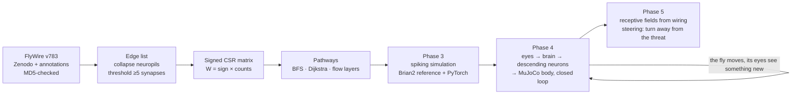
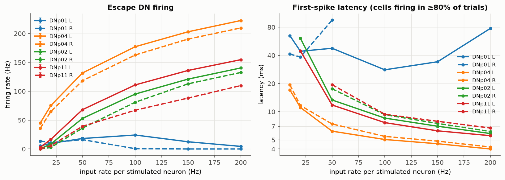
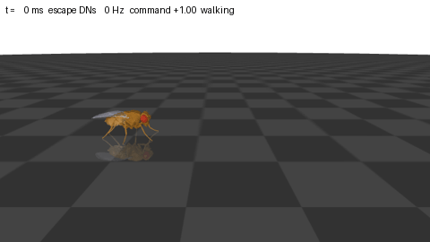
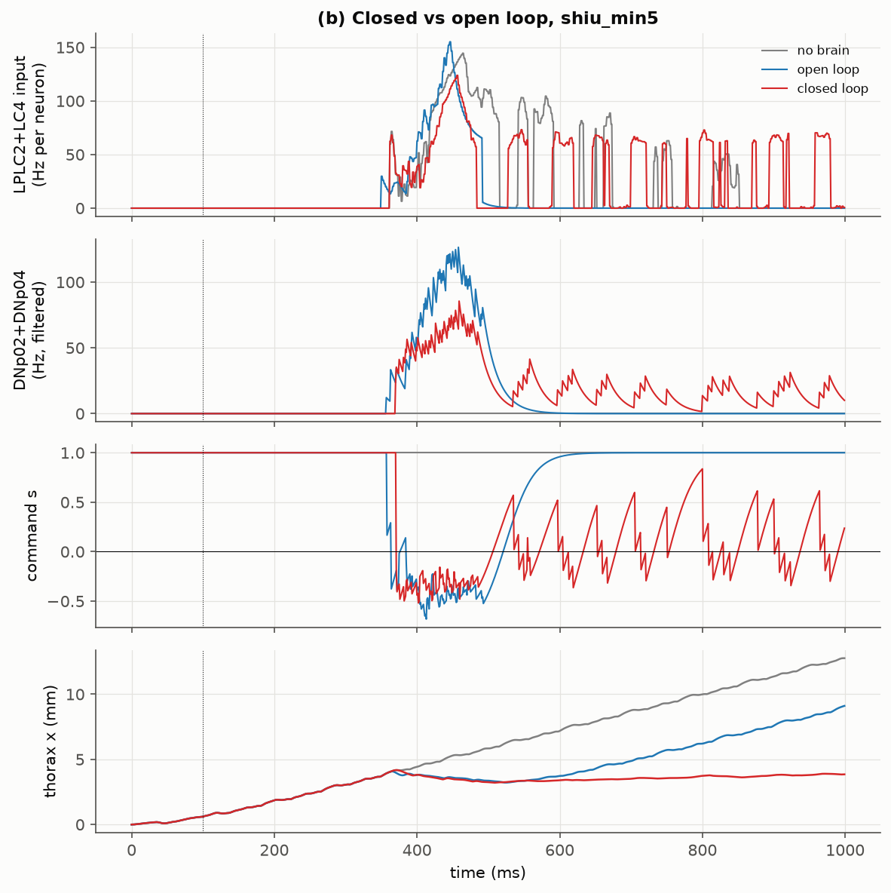
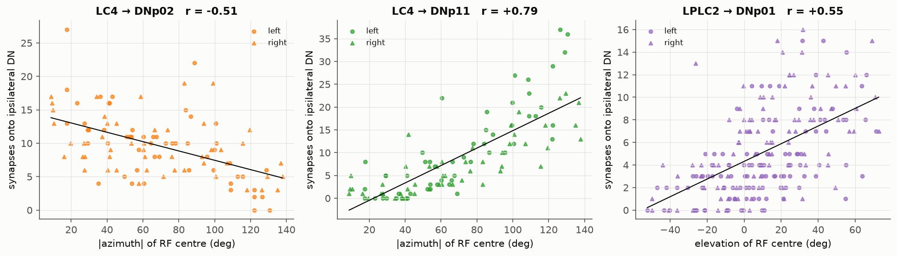
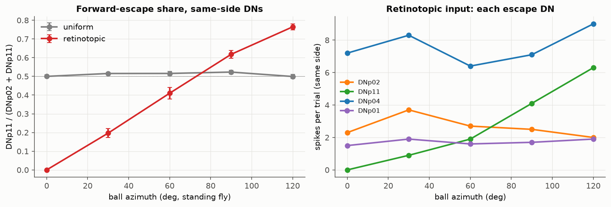
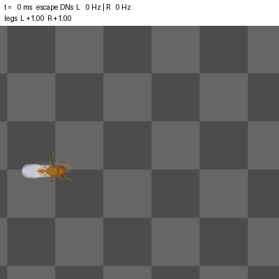

# connectome-control

A fly decides to escape in a few milliseconds. No training run, no reward shaping: the decision is
wired in. This project reads that wiring from the FlyWire whole-brain connectome of *Drosophila*
and asks a robotics question: **if you know which neural pathway produces which action, can you
use the brain's own wiring as a controller?**

**Status:** v1.0. The spiking brain drives a simulated fly body in MuJoCo. It sees a ball coming,
backs up about 10 ms after its looming detectors first fire, holds its distance from the ball (a
behaviour nobody programmed), and turns away from a ball that comes from the side. The direction it
should escape in is decided by how many synapses each eye neuron makes, as a 2023 *Nature* paper
predicted.

## The 30-second version

- A fly brain is 134,181 neurons and 2.7 million strong connections. I store it as one signed
  sparse matrix, so "who excites whom" becomes linear algebra.
- Behaviour leaves the brain through about 1,300 **descending neurons**, the brain's output
  channels to the legs and wings. Control those channels and you control the action.
- I traced how vision, touch, smell and taste reach those channels. The pipeline found the known
  escape circuit on its own, then showed something less obvious: escape is spread across a
  *population* of output neurons, not one.
- Then I made it move: every neuron became a spiking unit driven by that matrix. I reproduced a
  published whole-brain model, wrote a batched PyTorch simulator that matches it spike for spike,
  and showed which escape neurons fire first when something looms, which pathways they need, and
  how one modelling choice can switch the giant fiber off.
- Then I gave it a body: NeuroMechFly in MuJoCo, with compound eyes feeding the looming detectors
  and the escape neurons steering the legs, all in one 0.1 ms lockstep loop. Cut one input pathway
  and the escape comes 60 ms late; cut the other and the giant fiber loses 81% of its spikes.
- Then I gave every eye neuron its own patch of the visual field, worked out from its synapses, and
  let the fly steer. Where the threat is now decides which escape neurons fire, and the fly turns
  away from it, in every one of 28 off-axis runs.


*Cell-type circuit from photoreceptors to four escape descending neurons (FlyWire v783). Line width
is the share of the target's input; blue excitatory, orange inhibitory. Feed-forward edges only.*

## Why pathways are the control problem

A robot controller maps sensors to actuators. A brain does the same thing, except the map is
physical and you can read it. If I know that looming input reaches the giant fiber in three
synaptic steps, and that a different output neuron, DNp04, gets three times more of that looming
signal, I know *where* to intervene to change the behaviour and *what else* will change with it.
That is the same reasoning you use when deciding which joint torque or which feedback loop to
modify on a manipulator. The connectome just gives you the wiring diagram for free.



## What I found

| | |
|---|---|
| Neurons / strong connections / synapses | 134,181 / 2,700,513 / 34,153,566 |
| Neurons with a cell-type label | 134,171 (99.99%) |
| Descending neurons in the graph | 1,276 |
| Giant fiber input from LPLC2 + LC4 | 17% (left), 20% (right) |
| DNp04 input from LPLC2 + LC4 | 60% |
| Median hops to a DN: touch vs vision | 2 vs 4 |

**The pipeline recovers known biology without being told.** The two largest input types of the
giant fiber (the fly's fastest escape neuron) are LPLC2 and LC4, the looming detectors identified
in electrophysiology.

**Escape is a population.** The giant fiber is not even the top target of looming input. DNp04
gets three times its share, DNp02 about the same, and DNp11 a little less, which fits the idea of
graded escape choices spread over several output channels. For control, that is a much more useful structure than a single trigger.

**Touch is wired closest to action; vision farthest.** Mechanosensory neurons reach 70% of DNs
within two hops, and over 100 DNs get direct mechanosensory input. Photoreceptors reach only 2%
of DNs within two hops, because the optic lobes spend those layers turning pixels into features.

## Making it move (Phase 3)

Wiring is not behaviour. A fly neuron needs many inputs to line up before it fires (one
20-synapse input moves it less than 1 mV of the 7 mV it needs), and inhibition can cancel
excitation. So I turned all 134k neurons into leaky integrate-and-fire units, the model of
Shiu et al. (*Nature* 2024), and let `W` decide who kicks whom.



*LPLC2 and LC4 (314 neurons) driven at 10–200 Hz; 20 trials of 300 ms per rate. Left: firing rate.
Right: time to first spike. Solid left side, dashed right side.*

**First, prove the simulator.** Two implementations of the same model: Brian2 as the reference and
my own PyTorch version, batched over trials on a sparse matrix.

| Check | Result |
|---|---|
| Sugar neurons → feeding motor neuron MN9, on the paper's own connectome input | 62.7 / 88.8 Hz at 100 / 200 Hz input (paper: 67.0 / 93.3); 435 active neurons (paper: 448) |
| Same, on my connectome (≥5 synapses, per-synapse signs) | 57.0 / 86.5 Hz |
| Brian2 vs PyTorch, per-neuron rates, whole brain | r = 0.999–1.000, slope 1.00–1.02 |
| Same deterministic input, float64, 403-neuron sugar circuit | identical spikes at identical time steps |
| Same input, PyTorch in float32 | first different spike at 173 ms (rounding, then chaos) |
| Single neuron: PSP, delay, f–I curve | match the pen-and-paper answers |

**Then ask the robotics question.** Looming input (LPLC2 and LC4 driven together) fires three of
the four escape descending neurons strongly, and **DNp04 goes first**: 5.0–5.5 ms after onset at
100 Hz input, with the left and right DNp04 taking the first two places in almost every trial. DNp02 and DNp11 follow at 7.6–9.4 ms. Phase 2
predicted DNp04 from input shares alone: it gets three times the giant fiber's share of looming
input.

The giant fiber itself barely fires on my connectome: at most 24 Hz, and less as looming gets
stronger. On Shiu et al.'s version it fires reliably, second after DNp04 (5.4–6.2 ms). The two
versions differ in two ways. Theirs keeps every synapse; mine keeps connections with at least 5.
And mine signs every connection from its own transmitter prediction, while theirs gives each
neuron one sign for all its outputs. Those choices barely moved the feeding result, and they
decide whether the escape neuron fires.

Silencing cell types then showed what the static wiring could not:

- DNp02 and DNp11 run entirely on LC4; remove it and they go silent. DNp04 loses half or more of
  its firing without LC4 and only 12–17% without LPLC2, matching its 2:1 input shares.
- Silencing LC4 *doubles* the giant fiber's firing. On my signs, LC4's net effect on it is
  inhibitory, even though LC4 is one of its two largest inputs. Silencing LPLC2, or the relay
  neurons that make up 18% of its input, switches it off completely.
- For the other three DNs the relays are not needed at all: with every non-looming partner
  silenced, the direct one-synapse pathway carries the whole signal.

For a controller, that is the difference between a wiring diagram and a model: you can ask "what
happens if I cut this?" and get an answer in seconds, including answers the wiring diagram gets
backwards.

## Closing the loop (Phase 4)

A brain in a jar only answers "what fires?". With a body you can ask "what happens next?", because
whatever the fly does changes what it sees. So the brain from Phase 3 now runs inside a loop:

```
compound eyes (2 × 721 ommatidia) → looming detector → LPLC2 / LC4 → 134k spiking neurons
      ↑                                                                        ↓
NeuroMechFly body (MuJoCo) ← walking controller ← decoder ← escape descending neurons
```



*A 2 mm ball flies at the fly's head at 150 mm/s and stops 8 mm short. Top line: time, mean escape
DN rate, and the walking command (positive = forward, negative = backward). Played at 1/10 speed.*

Three pieces turn the simulator into a controller:

- **Encoder.** From the dark area on each eye: angular size (5.5° per ommatidium, within 6% of the
  geometry between 11° and 40°) and its expansion speed. LC4 gets Poisson input in proportion to
  speed, LPLC2 to size while the ball grows, which is what each cell type reports in recordings.
- **The brain as a stepper.** Phase 3's simulator, refactored to keep its state between calls.
  Stepping it 1 ms at a time gives bit for bit the same spikes as one long run (tested), so it can
  advance in lockstep with the physics: both use a 0.1 ms timestep.
- **Decoder.** Escape DN spikes → rates → a weighted average of three motor programs: walk, back up
  (DNp02 + DNp04, which make flies jump backward when activated) and run forward (DNp11). One
  free number. The giant fiber triggers takeoff, which a walking-only body can't do, so it is logged.



*Grey: brain disconnected, the fly walks under the ball. Blue: the looming input recorded from a
standing fly, replayed into the brain. Red: the brain sees through its own eyes.*

| 3 seeds each | Backward command after first input | Closest gap to ball | Gap after the ball stops | Giant fiber spikes |
|---|---|---|---|---|
| No brain | never | 1.3 mm (walks under it) | – | – |
| Open loop (replayed input) | 13–14 ms | 0.7–1.4 mm | 1.3–1.9 mm | 22–24 |
| **Closed loop** | **8–15 ms** | **2.8–3.0 mm** | **3.0–3.3 mm** | 74–83 |
| Closed, LC4 silenced | 53–88 ms | 1.8–1.9 mm | 1.9–2.1 mm | 72–76 |
| Closed, LPLC2 silenced | 8–15 ms | 1.9–2.3 mm | 2.4–2.5 mm | 10–17 |

**The reflex is the same, open or closed: what happens after it is not.** Replayed input backs the
fly up, then goes quiet when the ball stops, and the fly walks on under it. In closed loop, every
step forward makes the ball grow on its retina again, DNp04 fires, and the command dips below zero.
The fly hovers about 3 mm from the ball for the last half second. Nothing in the code says "keep
your distance": the gap is a set point of a feedback loop, where backward drive from the brain
balances the tonic walking drive.

**Silencing in a loop separates jobs that fixed input blurs.** Before running it I predicted, from
Phase 3's rates pushed through the decoder, that neither silencing would change the escape. Wrong
twice. Without LC4 the escape starts about 60 ms late: at the start of a real approach the ball is
small but already expanding fast, so LC4 (speed) is the only channel with anything to say. Without
LPLC2 the onset is unchanged, but the giant fiber loses 81% of its spikes, which is the 2019
finding that LPLC2 is necessary for giant-fiber escape, recovered from wiring alone. Both shrink
the standoff: less gain from looming to backing up, so the set point moves closer.

**Which connectome?** Phase 3 left a question: on my graph the giant fiber barely fires, on Shiu
et al.'s it fires second. A one-change-at-a-time chain of graph variants answers it: keeping my
≥5-synapse edges but giving each neuron one sign (`shiu_min5`) makes it fire like the full graph
(142–169 Hz vs 153–172 Hz at 100 Hz input). Counting modulatory synapses as excitatory on my own
signs (`ours_mod`) only lifts it from 0–24 Hz to 11–51 Hz. The synapse threshold is harmless here;
the per-edge vs per-neuron sign rule decides. Phase 4 runs on `shiu_min5`: it matches recordings (LC4 and LPLC2 excite the giant
fiber), respects Dale's principle, and is 5.6× smaller than the full graph.

## Which way to run (Phase 5)

Phase 4's fly knew *that* something was coming, not *where* from: every looming detector on one
side got the same input, and both sides of the body got the same command. Real flies jump backwards
from a threat in front and forwards from one behind. Dombrovski et al. (*Nature* 2023) found part
of the wiring for that: LC4 neurons that look forward make more synapses onto DNp02 (backward
escape), those that look back make more onto DNp11 (forward escape). The direction of the escape
is stored in synapse counts.

To use that, each of the 314 looming detectors needs to know where it looks. No electrodes, so I
read it off the wiring. The optic lobe is built from columns, one per ommatidium, and a columnar
cell's column says where it looks. Chaining a published column map of FlyWire (Matsliah et al. 2024)
with a micro-CT map of where every ommatidium points (Zhao et al. 2025, measured on a different
fly) gives each columnar cell a direction, and each LPLC2/LC4 neuron a receptive field: where its
input synapses come from. Checked on the side where the true columns are known: centres within 1.2°.



*Synapses from each LC4 (or LPLC2) neuron onto the same-side escape neuron, against where its
receptive field is. Every point is one neuron; its position comes from my receptive fields, not the
paper's.*

**The predicted gradients are there** (LC4 → DNp11 r = +0.79, LC4 → DNp02 r = −0.51, LPLC2 → giant
fiber r = +0.55, all p < 1e-7), and every one of these synapses stays on its own side of the brain.

**And they do what they were predicted to do, but only if the input is retinotopic.** Recording
what a standing fly's eyes see and replaying it into the brain alone:



| ball direction | 0° (ahead) | 30° | 60° | 90° | 120° (behind) |
|---|---|---|---|---|---|
| forward-escape share, retinotopic input | **0.00** | 0.20 | 0.41 | 0.62 | **0.76** |
| forward-escape share, uniform input (Phase 4) | 0.50 | 0.52 | 0.52 | 0.52 | 0.50 |

*Share of DNp11 in DNp02 + DNp11 spikes on the ball's side, 10 trials each.*

With a receptive field per neuron, a ball ahead gets a purely backward program and a ball from
behind a mostly forward one, which is the behaviour measured in flies (Card & Dickinson 2008),
falling out of synapse counts. With Phase 4's uniform input the share is flat: the gradients are
still in the wiring, but the encoder has already averaged away the information they read. **An
encoder can erase exactly what the downstream wiring is built to use.**

**Steering.** flygym's walking controller takes one number per side of the body, so it steers like
a differential-drive robot. I measured its steering curve first (≈265°/s per unit of left/right
difference when walking forward, about a sixth of that when walking backwards), then added a turning term
to the decoder: more escape activity on the left turns the fly right. One new gain.



*A ball from the left. Only the left escape neurons fire, the left legs step harder, the fly turns
about 50° right and walks off. 1/10 speed.*

| 3 seeds per direction | ball from the left (45°, 90°) | ball from the right (−45°, −90°) | ahead (bearing −2°) |
|---|---|---|---|
| turned away, uniform input | 6 / 6 (46–74° right) | 6 / 6 (37–60° left) | backed straight away |
| turned away, retinotopic input | 6 / 6 (28–58° right) | 6 / 6 (23–53° left) | barely turned (3°) |

Two caveats the numbers make me state. Turning away doesn't need retinotopy: left vs right was
already in Phase 4's per-eye input, and uniform input actually turns harder because it drives twice
as many escape spikes. What retinotopy adds is the forward/backward choice above, and in the walking
body that choice is blurred: a fly that is backing up can barely steer. The clean test is the
brain-alone replay; the closed loop shows the result survives a body and feedback. (The two
"frontal" seeds whose ball arrived 13–27° off-centre also turned away; they're counted in the 28.)

<details>
<summary><b>Things that surprised me</b></summary>

- **Phase 1:** the most connected neuron has 5,080 strong inputs; the average has 20. The mushroom
  body is ~80% excitatory while the heading compass (ellipsoid body) is ~69% inhibitory.
- **Phase 2:** the two giant fibers disagree on their predicted transmitter. The left is predicted
  cholinergic, the right glutamatergic. The giant fiber is a well-characterised cholinergic neuron,
  so one prediction is wrong, which is a good reminder that every sign in `W` is a prediction.
- **Phase 2:** the strongest *single-neuron* path from the eye to the giant fiber skips T4/T5,
  the famous motion detectors. Each T4 neuron contributes only a few synapses, so no single edge
  looks strong. Collapsing to cell types brings the population back.
- **Phase 2:** almost every neuron is within 3 hops of some sensory neuron. Hop count saturates
  fast in a hub-heavy graph, which is why I added a probabilistic layering model.
- **Phase 3:** my PyTorch simulator drifted from Brian2 in a 60-neuron test: one neuron fired 0.7 ms
  early at 35 ms, and the difference spread from there. The cause: Brian2 throws away any input that arrives while a neuron is refractory, instead of
  storing it. Nothing in the paper says this; I found it with a two-neuron probe and Brian2's
  source code. After that, the two simulators matched to 1e-12 mV.
- **Phase 3:** my test for that bug passed even with the fix deleted. The input only leaks on the
  very last refractory step, so I added that edge case. Now I always break the code once to check
  that a test can fail.
- **Phase 3:** dropping weak (<5 synapse) connections, 82% of all pairs, looked like harmless
  cleanup in Phase 1. In the simulation it matters: those tiny inputs add up, and without them MN9
  needs noticeably more sugar input to fire (25 vs 50 Hz at 75 Hz input).
- **Phase 3:** for feeding, how I built the connectome made little difference. For escape it decides
  everything: on my version the giant fiber stays almost silent, on the paper's it fires at 6 ms.
  The Phase 2 lesson that every sign is a prediction turned out to matter more than I expected.
- **Phase 3:** LPLC2 has no direct synapses onto DNp02, yet silencing LPLC2 makes DNp02 fire up to
  43% *more*. It inhibits it through other neurons, which no input-fraction table shows.
- **Phase 3:** the paper's "right-side" sugar neurons are labelled left in the current annotations,
  while 20 of their 21 IDs survived unchanged from FlyWire release 630 to 783. Match neurons by ID, never
  by side label.
- **Phase 4:** the fly simulator I planned around was rewritten from scratch in March 2026. flygym
  2.x shares a name with 1.x and almost nothing else, so every tutorial I had bookmarked was wrong.
  I read the new source before writing a line.
- **Phase 4:** a ball straight ahead sits on the seam between the two eyes. While the fly walks,
  its head sways and the ball hops from one eye to the other, so each eye alone sees it blink in and
  out. Taking the larger of the two eyes' estimates fixed it.
- **Phase 4:** rendering 1,442 ommatidia takes about 80% of the wall-clock time; the 134k-neuron
  brain takes about 5%. And in the latency budget the filters (15 ms encoder, 20 ms decoder, 50 ms
  gait oscillators) dwarf the 5–10 ms of neural processing. The slow parts are the engineering.
- **Phase 4:** I wrote down what silencing LC4 and LPLC2 would do before running it, and got both
  wrong. A steady-input table can't show that one channel is the early warning; you need a ball
  that actually approaches.
- **Phase 4:** the hovering came as a surprise. I gave the ball a stop so the runs would end
  cleanly, and the closed-loop fly turned the stop into a standoff.
- **Phase 5:** an eye map measured with micro-CT on one fly, drawn on the grid of a different
  connectome, lined up with FlyWire's columns with a single shift: 794 of 796 columns. Two flies,
  two labs, one lattice.
- **Phase 5:** my first "frontal" ball arrived 13° to the right. The walking controller drifts left
  about 13° per second, so by the time the ball got close, straight ahead had moved. The ball now
  aims where the fly will be, like a predator leading its target.
- **Phase 5:** I expected retinotopy to be what makes the fly turn. It isn't: Phase 4's input already
  knew left from right. Its real contribution, the forward/backward choice, only showed up when I
  took the body away and replayed the input into the brain alone.
- **Phase 5:** the backward gait has about a sixth of the forward gait's steering authority, so a
  fly that is backing away from something can hardly turn. Measuring the actuator before writing
  the controller saved me from blaming the brain for a body limit.
- **Phase 5:** two gradients I wasn't looking for: ventral-looking LC4s and front-looking LPLC2s
  make more synapses onto DNp04. I haven't found them in the papers I read.

</details>

<details>
<summary><b>How the pathway analysis works</b></summary>

Everything runs on the signed matrix from Phase 1, where `counts[i, j]` is the number of synapses
from neuron *j* onto neuron *i*.

- **Hop distance (BFS).** The frontier is a boolean vector `f`; the next layer is every unvisited
  neuron with `(counts @ f) > 0`. One sparse matrix-vector product per layer, ~0.15 s for the
  whole brain.
- **Strongest paths (Dijkstra).** Edge weight = input fraction, the share of a neuron's input that
  comes from one partner. Maximising the product of fractions along a path is the same as
  minimising the sum of `-log(fraction)`, which Dijkstra solves exactly. All seeds run as one
  super-source.
- **Signed path effect.** Product of signs times product of fractions. Two inhibitory steps make
  disinhibition (net excitation); a modulatory step zeroes the chain. `multihop_effect` sums this
  over every walk of length *k* with repeated matrix-vector products.
- **Information-flow layers.** The traversal model of Schlegel et al. (2021): a neuron passes the
  signal on with probability `min(1, fraction / 0.3)`. Averaged over many random runs, this gives a
  depth that one weak synapse cannot fake. Runs are vectorised by turning "probability that no
  input succeeds" into a log-space sparse matrix product.
- **Cell-type graph.** The same functions run on a graph with one node per cell type (8,837 nodes).

All of it is covered by pytest tests on hand-built circuits with known answers, including one
where the strongest path is deliberately longer than the shortest.

</details>

<details>
<summary><b>How the spiking simulation works</b></summary>

- **Neuron model.** Leaky integrate-and-fire: membrane potential `v` leaks to -52 mV (20 ms), synaptic
  drive `g` decays in 5 ms, a spike at -45 mV resets and freezes the neuron for 2.2 ms, and each
  spike adds `0.275 mV × synapse count` to its targets' `g` after 1.8 ms. Constants verified
  against the authors' code. `w_syn` is the only fitted number.
- **Exact integration.** Between spikes the equations are linear, so each 0.1 ms step is the 2×2
  matrix exponential, not an Euler approximation. That is also what lets two independent
  simulators agree bit for bit.
- **Batching.** State is a (neurons × trials) tensor, so 30 trials or a whole stimulus-rate sweep
  is one simulation; each column can have its own input rate.
- **Sparse spike delivery, two kernels.** Event-driven (gather the outgoing synapses of the few
  neurons that spiked, scatter-add them with `index_add_`) or one `torch.sparse` CSR matrix
  product per step. Under sensory drive ~0.3% of neurons are active, so event-driven is ~5×
  faster on a CPU; SpMM is the better fit for dense activity on a GPU.
- **Refractoriness without a mask.** Refractory neurons sit at exactly (reset, 0), so the
  simulator remembers who spiked recently and pins those few entries, instead of testing all
  4 million (neuron, trial) pairs every step (together with storing spikes as index lists, 4×
  faster).
- **Four versions of the connectome** (ours vs the paper's: synapse threshold, per-edge vs
  per-neuron signs, modulatory transmitters) separate what each modelling choice changes.
- **Tests.** 23 new pytest tests: f–I curve vs the analytic formula, PSP shape and delay to 1e-9 mV,
  excitation/inhibition, refractory edge cases, Brian2 = PyTorch spike for spike, and statistical
  agreement under noise. 65 tests in total.

</details>

<details>
<summary><b>How the closed loop works</b></summary>

- **Body.** NeuroMechFly v2 through flygym 2.1 (MuJoCo): legs-only fly, 42 position-controlled leg
  joints, adhesion pads, two compound eyes of 721 ommatidia. Its walking controller (a CPG in a
  tripod gait plus two leg reflexes) takes a two-number "descending signal", left and right:
  magnitude = stepping amplitude, sign = direction.
- **Encoder.** Dark area on each eye → angular size (5.5° per ommatidium, calibrated against
  geometry) → expansion speed. LC4 gets a Poisson rate proportional to speed, LPLC2 proportional to
  size while the object expands, matching what each cell type encodes in recordings.
- **Brain.** The Phase 3 simulator, refactored into a stepper that keeps its state between calls.
  Stepping it 1,000 times for 1 ms gives bit-for-bit the same spikes as one 1-second run (tested).
- **Decoder.** Escape DN spike counts → rates (20 ms filter) → a weighted average of three motor
  programs: walk (weight 1), back up (DNp02 + DNp04), run forward (DNp11), each escape weighted by
  its rate / 40 Hz. The giant fiber is read out as a takeoff trigger but the body can't fly.
- **Lockstep.** Brain dt and physics timestep are both 0.1 ms. Every 1 ms tick: render eyes (every
  2 ms), step the brain 10 steps, decode, step the body 10 steps with the *previous* tick's command,
  so the loop stays causal.
- **Tests.** Stepped = one-shot brain (bit for bit), encoder vs geometry on the real eyes, decoder
  limits, loop causality (break it and the test fails). 20 new tests, 85 in total.

</details>

<details>
<summary><b>Where else this applies</b></summary>

The tools here are about directed, weighted, signed graphs, not flies specifically.

- **Robot control architectures:** the same "which inputs reach which actuators, and how
  strongly" analysis applies to large learned policies, where you want to know which sensors
  actually drive a motor command.
- **Neural network interpretability:** strongest-path and multi-hop effect are close cousins of
  attribution methods that trace a decision back through layers.
- **Fault propagation:** BFS layers and signed path products describe how a failure or a
  disturbance spreads through a power grid, a supply chain or a control loop.
- **Biomechanics:** the descending neurons are where the brain hands off to the body. Connecting
  them to a musculoskeletal model is exactly the interface between neural control and mechanics.
- **Robot control loops:** the Phase 4 loop is a sensor → estimator → policy → low-level controller
  stack. Its lessons transfer directly: sample rates, zero-order holds, a one-tick delay for
  causality, and latency budgets dominated by filters rather than the policy.
- **Sensor encoding for learned or wired policies:** Phase 5's uniform encoder fed the brain the
  right features and still threw away the direction, because it pooled over space before the
  policy could. Same failure as global-average-pooling a camera image before a controller that
  needs to know where the obstacle is.
- **Sensor-to-actuator calibration:** the steering curve is system identification of a
  differential-drive base; measuring it first showed which behaviours the body could not produce
  whatever the controller asked for.

</details>

<details>
<summary><b>How the directional escape works</b></summary>

- **Columns → directions.** Matsliah et al.'s 796 FlyWire columns, shifted onto Zhao et al.'s
  eye map by the lattice offset that overlaps the most sites (794 / 796); orientation checked
  against lamina cell-body positions. Left optic lobe: an iterative-closest-point reflection
  (orthogonal Procrustes with det = −1) maps left cell bodies onto right ones of the same type.
- **Receptive fields.** Centre = synapse-weighted mean direction of a neuron's columnar inputs;
  width = their weighted angular spread. Widths scaled by one factor so the median LPLC2 matches
  its measured 60° receptive field.
- **Eye geometry.** Each flygym ommatidium's viewing direction, by running its renderer
  backwards: corrected pixel → fisheye lookup → ray through the pinhole → world. Tested by placing
  a ball along computed directions (within 3°).
- **Encoder.** Rate = Phase 4's feature tuning (size or expansion speed) × a Gaussian spatial
  factor: how close to the neuron's centre the dark object reaches. When every centre is covered it
  reduces exactly to the Phase 4 encoder (tested).
- **Steering decoder.** Differential drive: left = v + w, right = v − w. v is Phase 4's command;
  w = k × (left − right escape drive) / (1 + left + right). Every mapping is a stated assumption
  with its source, in `decoder.py`.
- **Tests.** 23 new: lattice registration on a known shift, mirror fit on a known reflection,
  receptive field by hand, the encoder's Gaussian tuning and population code, the decoder's
  symmetry and limits, the experiment readouts, plus the gradient check on real data. 108 in total.

</details>

## Quick start

```powershell
python -m venv .venv
.\.venv\Scripts\Activate.ps1
pip install -e ".[dev]"
python scripts/download_data.py     # connectivity (Zenodo) + annotations (GitHub v3.2.0), MD5-checked
python scripts/build_graph.py       # -> data/processed/graph_v783_min5.npz
pytest
jupyter lab notebooks/02_pathway.ipynb

# Phase 3: spiking simulation
pip install -e ".[dev,sim]"         # + Brian2 and PyTorch
python scripts/download_data.py --shiu
python scripts/run_phase3.py        # caches every simulation (~1 h on a laptop CPU)
jupyter lab notebooks/03_spiking.ipynb

# Phase 4: closed loop (needs Python >= 3.12 for flygym 2.x)
pip install -e ".[dev,sim,control]"  # + flygym (NeuroMechFly v2, MuJoCo)
python scripts/run_phase4.py --factorial   # which connectome? + every closed-loop run (~30-60 min)
jupyter lab notebooks/04_control.ipynb

# Phase 5: directional escape
python scripts/download_data.py --minimal  # annotations + Shiu table + eye map (no 1 GB Zenodo file)
python scripts/run_phase5.py               # receptive fields, gradients, every run (~1-2 h)
jupyter lab notebooks/05_directional.ipynb
```

Only want the closed-loop fly? `pip install -e ".[dev,sim,control]"`, then
`python scripts/download_data.py --minimal` and `python scripts/run_phase5.py --seeds 0` (~30 min).

## Roadmap
- [x] Phase 0: data pipeline (download, checksums, neuropil collapse, threshold)
- [x] Phase 1: the brain as a signed sparse graph — `v0.1-graph`
- [x] Phase 2: tracing sensorimotor pathways to the descending neurons — `v0.2-pathway`
- [x] Phase 3: spiking simulation (Brian2 reference + PyTorch, batched, CPU/GPU) — `v0.3-spiking`
- [x] Phase 4: closed-loop control of a simulated fly body in MuJoCo — `v0.4-control`
- [x] Phase 5: receptive fields from wiring, directional escape and steering — `v1.0`
- [ ] Ideas beyond v1.0: a takeoff program for the giant fiber (a body that can fly), motion
  detectors inside each receptive field instead of the separable model, and steering through the
  fly's own steering neurons (DNa02) instead of a functional map

## Repository layout
```
src/c2c/data/loaders.py            raw FlyWire table -> collapsed, thresholded edge list
src/c2c/data/graph.py              edge list -> signed CSR matrix, home neuropils, .npz save/load
src/c2c/data/annotations.py        cell-type labels joined onto the graph, sensory modalities
src/c2c/analysis/graph_stats.py    degree, weight, region and E/I statistics + figures
src/c2c/analysis/pathways.py       BFS, strongest paths, signed effects, flow layers, cell-type graph
src/c2c/analysis/pathway_plots.py  circuit diagram and Phase 2 figures
src/c2c/data/shiu.py               Shiu et al. 2024 connectome input as a Graph, sugar/MN9 IDs
src/c2c/sim/params.py              LIF constants and the exact one-step propagator
src/c2c/sim/network.py             weight matrix, silencing, SimResult, caching
src/c2c/sim/brian_lif.py           Brian2 reference simulator
src/c2c/sim/torch_lif.py           batched sparse PyTorch simulator (event-driven or SpMM)
src/c2c/analysis/spiking.py        sweeps, readout tables, simulator comparison, plots
src/c2c/analysis/phase3.py         the Phase 3 experiments, cached
src/c2c/control/body.py            NeuroMechFly v2 (flygym 2.1), walking controller, looming ball
src/c2c/control/encoder.py         compound eye -> LPLC2 / LC4 Poisson rates (uniform or retinotopic)
src/c2c/control/decoder.py         escape DN spikes -> walking command (+ steering)
src/c2c/control/loop.py            the brain-body loop in 1 ms lockstep, open-loop replay
src/c2c/analysis/phase4.py         the Phase 4 experiments, cached; the giant-fiber factorial
src/c2c/data/eyemap.py             columns + eye map -> viewing directions -> receptive fields
src/c2c/analysis/phase5.py         the Phase 5 experiments, cached; gradients, replay, steering curve
scripts/run_phase3.py              run every Phase 3 simulation from a terminal
scripts/run_phase4.py              run every Phase 4 simulation from a terminal
scripts/run_phase5.py              run every Phase 5 computation from a terminal
notebooks/                         01_graph … 05_directional.ipynb
tests/                             pytest on small hand-built circuits
```

## About

Built by Rithika, a mechanical engineering (robotics and control) grad student who likes taking
things apart, from hardware on the bench to biomechanics research. This is the same habit pointed
at a brain.

## Data and credits
Connectivity: FlyWire v783 (CC-BY 4.0), Dorkenwald et al. 2024; neurotransmitter predictions from
Eckstein et al. 2024. Annotations: flyconnectome/flywire_annotations v3.2.0 — Schlegel et al. 2024,
Dorkenwald et al. 2024, Berg et al. 2026, Tastekin et al. 2026, Matsliah et al. 2024.
Information-flow model: Schlegel et al. 2021 (eLife). Whole-brain LIF model and its connectome input:
Shiu et al. 2024 (*Nature*), github.com/philshiu/Drosophila_brain_model. Simulators: Brian2
(Stimberg et al. 2019, eLife) and PyTorch. Body: NeuroMechFly v2 (Wang-Chen et al. 2024, *Nature
Methods*) through flygym 2.1 and MuJoCo. Looming encoding: von Reyn et al. 2017 (*Neuron*), Ache et
al. 2019 (*Curr. Biol.*). Escape DN behaviours: Peek 2018 (PhD thesis, U. Chicago), Dombrovski et
al. 2023 (*Nature*). Column assignments: Matsliah et al. 2024 (*Nature*); ommatidium viewing
directions: Zhao et al. 2025 (*Nature*); both as packaged in github.com/YijieYin/connectome_interpreter
(MIT). Escape direction vs threat direction: Card & Dickinson 2008 (*Curr. Biol.*). LPLC2 receptive
field size: Klapoetke et al. 2017 (*Nature*).
